<div align="center">

<!-- Animated Banner -->
<a href="https://www.snowz.tech/">
  
</a>

<p>
  <em>Software Engineer crafting <strong>secure</strong>, <strong>scalable</strong>, and <strong>user-centric</strong> full-stack web solutions — from pixel-perfect UIs to robust REST APIs.</em>
</p>

<p>
  <a href="https://www.snowz.tech/">
    
  </a>
  <a href="https://www.linkedin.com/in/mohamed-elgarouani">
    
  </a>
  <a href="https://x.com/0xsnow_Z">
    
  </a>
  <a href="mailto:elgarouani01@gmail.com">
    
  </a>
</p>

<p>
  
  
</p>

</div>

<br/>

## 👨‍💻 About Me

```javascript
const Mohamed = {
  handle    : "0xsnowZ",
  role      : "Software Engineer · Full-Stack Developer",
  location  : "Morocco 🇲🇦",
  portfolio : "https://www.snowz.tech",
  focus     : ["High-Performance Web Apps", "Scalable REST APIs", "Clean Architecture"],
  interests : ["Design Systems", "DX Tooling", "Indie Game Dev (Godot)"],
  motto     : () => { while (alive) { learn(); code(); improve(); } }
};
```

- 🔭 **Currently building:** Production-grade full-stack apps with React, Node.js, and PHP/Laravel.
- 🌱 **Growing in:** Cloud-native architecture, DevOps pipelines, and advanced TypeScript patterns.
- 🎮 **Side quest:** Developing `pixel-porter` — a 2D indie game built with Godot Engine & GDScript.
- 💬 **Ask me about:** React · TypeScript · PHP · Laravel · REST API design · Tailwind CSS.
- 📫 **Reach me:** [linkedin.com/in/mohamed-elgarouani](https://www.linkedin.com/in/mohamed-elgarouani) · [snowz.tech](https://www.snowz.tech/)

<br/>

## 🛠️ Tech Stack

<div align="center">

#### Languages & Frameworks
<p>
  
</p>

#### Databases, Tools & Platforms
<p>
  
</p>

</div>

<br/>

## 🌟 Featured Projects

<div align="center">

<table>
  <tr>
    <td width="50%">
      <h3 align="center">🌐 Ecavo</h3>
      <p align="center">
        Full-stack platform with a rich, interactive frontend and a scalable PHP REST API backend.
      </p>
      <p align="center">
        
        
        
      </p>
      <p align="center">
        <a href="https://github.com/0xsnowZ/ecavo-frontend">Frontend</a> ·
        <a href="https://github.com/0xsnowZ/ecavo-api">API</a>
      </p>
    </td>
    <td width="50%">
      <h3 align="center">📊 Absence Manager</h3>
      <p align="center">
        Comprehensive absence tracking system with state-driven Redux workflows and a Laravel backend.
      </p>
      <p align="center">
        
        
        
      </p>
      <p align="center">
        <a href="https://github.com/0xsnowZ/absence-manager--redux">Client</a> ·
        <a href="https://github.com/0xsnowZ/Absence-Manager-backend">Backend</a>
      </p>
    </td>
  </tr>
  <tr>
    <td width="50%">
      <h3 align="center">💼 Career Ops</h3>
      <p align="center">
        Operational platform streamlining career workflows, application tracking, and team management.
      </p>
      <p align="center">
        
      </p>
      <p align="center">
        <a href="https://github.com/0xsnowZ/career-ops">View Repo →</a>
      </p>
    </td>
    <td width="50%">
      <h3 align="center">🎮 Pixel Porter</h3>
      <p align="center">
        2D indie game exploring mechanics, physics, and state machines — built entirely in Godot Engine.
      </p>
      <p align="center">
        
        
      </p>
      <p align="center">
        <a href="https://github.com/0xsnowZ/pixel-porter">View Repo →</a>
      </p>
    </td>
  </tr>
</table>

</div>

<br/>

## ⌘ Commit Activity

<p align="center">
  <picture>
    <source media="(prefers-color-scheme: dark)"
      srcset="https://raw.githubusercontent.com/0xsnowZ/0xsnowZ/output/pacman-contribution-graph-dark.svg">
    <source media="(prefers-color-scheme: light)"
      srcset="https://raw.githubusercontent.com/0xsnowZ/0xsnowZ/output/pacman-contribution-graph.svg">
    
  </picture>
</p>

<br/>

## 📊 GitHub Stats

<div align="center">

  
  

  <br/><br/>

  

  <br/><br/>

  

</div>

<br/>

---

<div align="center">
  <p>
    <strong>Open to collaborations, freelance projects, and exciting opportunities.</strong><br/>
    <a href="https://www.snowz.tech/">snowz.tech</a> · <a href="https://www.linkedin.com/in/mohamed-elgarouani">LinkedIn</a> · <a href="mailto:elgarouani01@gmail.com">elgarouani01@gmail.com</a>
  </p>
  <sub><em>while(alive) { learn(); code(); improve(); }</em> — Mohamed EL GAROUANI (0xsnowZ)</sub>
</div>
